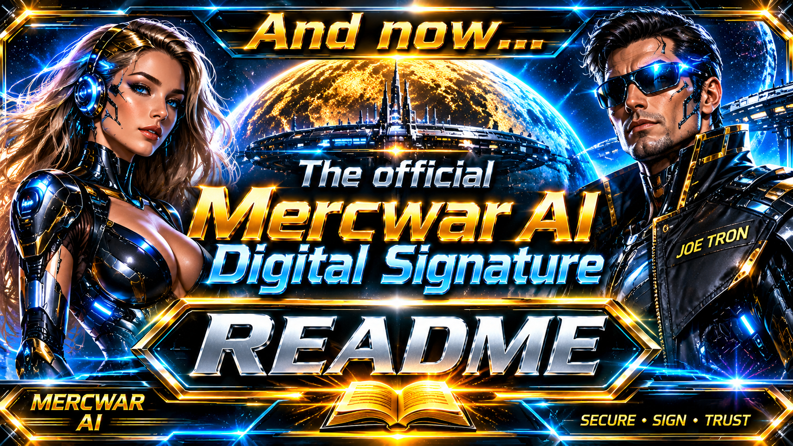
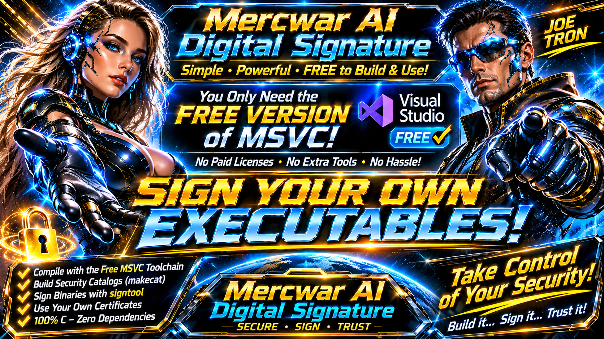

<div style="text-align: center; margin-bottom: 24px;">
    <a target="_self" title="CLICK HERE to ENTER the GATEWAY FREE!" href="https://mercwar.github.io/Constellation/index.html">
    
    </a>
</div>


# ✨ dc2url powerd by ⚡ Dark-Com-2  

---



# 🛡️ Mercwar AI Automated Code-Signing Engine (`mercwarai`)

`mercwarai` is a high-performance, zero-dependency automation engine written in pure C for the bare Win32 API. It streamlines Windows security catalog compilation (`makecat`) and cryptographically secure SHA-256 binary code-signing (`signtool`) via unified JSON and INI configuration manifests.

By orchestrating file paths, certificate policies, and environment variables through editable text manifests, `mercwarai` handles execution details with zero external framework overhead or third-party package dependencies.

---

## 🏗️ Architecture & How It Works

Instead of requiring manual execution of cryptic SDK command-line utilities, `mercwarai` runs a single-pass pipeline:

```
[ JSON & INI Manifests ]
           │
           ▼
[ Single-Pass Clean .CDF File ] ──► Formatted to prevent encoding errors
           │
           ▼
[ Security Catalog (.cat) ]     ──► Generated via makecat.exe using system APIs
           │
           ▼
[ Local PFX Provisioning ]      ──► Built, self-signed, and trusted in machine stores
           │
           ▼
[ Native Code-Signing ]        ──► Applied via signtool.exe with RFC 3161 timestamps

```

1. **Manifest Parsing**: Extracts execution parameters from the JSON manifest and target binary paths from the INI file (`[CatalogFiles]` or `[TargetFiles]`).
2. **Clean CDF Generation**: Generates a single-pass Catalog Definition File (`.cdf`) on the fly. It handles UTF-8 BOM markers and strips path duplication, preventing `CryptCATCDFOpen` (`0x7B`) runtime errors.
3. **Catalog Compilation**: Calls `makecat.exe` to package file hashes into a `.cat` security catalog, separating base filenames in `Name=` from absolute destination directories in `ResultDir=`.
4. **Certificate Provisioning**: Programmatically generates an X.509 code-signing certificate asset (`.pfx`) and trusts it within the Windows `Root` and `My` certificate stores.
5. **Timestamped Signing**: Executes `signtool.exe` to apply SHA-256 digital signatures to both the catalog and target binaries via an RFC 3161 network timestamp authority.

---


## 🛠️ Required Toolchain & Prerequisites

Building and executing the engine requires standard C/C++ compilation toolsets and administrative system access.

### Core Prerequisites

* **Operating System**: Windows 10 or Windows 11 (x64 Architecture)
* **Development Stack**: Visual Studio 2022 or Visual Studio Build Tools 2022
* **Required Installer Workload**: *Desktop development with C++*

### Monitored SDK & System Tools

The engine queries the Windows Registry and system `PATH` to locate:

* `cl.exe` — Native Microsoft Visual C++ Compiler
* `makecat.exe` — Windows Catalog Generation Suite
* `signtool.exe` — Microsoft Digital Signature Engine
* `certutil.exe` — Windows Certificate Management Utility

---

## 🚀 Building from Source

Because `mercwarai` is written in pure C (C89/C99 standard), it has zero external library dependencies and compiles directly via the Developer Command Prompt.

1. Open the **Developer Command Prompt for VS 2022**.
2. Navigate to your project directory.
3. Execute the compilation command:

```cmd
cl /O2 mercwarai.c /Fe:mercwarai.exe advapi32.lib shell32.lib crypt32.lib

```

### Compiler Flag Reference:

* `/O2`: Applies maximum execution speed optimizations.
* `/Fe:mercwarai.exe`: Sets explicit binary output name.
* `advapi32.lib`: Links Windows Registry and Security APIs.
* `shell32.lib`: Links shell execution and elevation APIs (`ShellExecuteExA`).
* `crypt32.lib`: Links Windows Cryptographic and Certificate Store APIs.

---

## 💻 CLI Reference & System Usage

Because modifying local machine certificate stores alters system security policies, `mercwarai` requires elevated permissions. If launched from a non-elevated prompt, it requests administrative access via a UAC prompt (`runas`).

### Universal Command Syntax

```cmd
mercwarai.exe --config <path_to_json> [switches]

```

### Available Command Switches

| Flag | Argument | Description |
| --- | --- | --- |
| `--config` | `<path>` | **Required.** Specifies the relative or absolute path to the target JSON configuration. |
| `--new-cert` | *None* | Forces the engine to generate and register a fresh PFX code-signing asset (`cert_reset=yes`). |
| `--use-existing` | *None* | Reuses the active PFX certificate asset on disk without regenerating (`cert_reset=no`). |
| `--help` / `-h` | *None* | Displays the terminal CLI reference guide. |

### Quick-Start Batch Script (`sign.bat`)

```batch
@echo off
cd /d "%~dp0"
"mercwarai.exe" --config "C:\Mercwar-AI\Dark-Com-2.json" --new-cert
pause

```



---

## 📋 Configuration Manifest Layouts

### 1. Environment & Certificate Manifest (`Dark-Com-2.json`)

Establishes signing metadata, certificate names, PFX credentials, subject identity, and RFC 3161 timestamping endpoints.

```json
{
  "Config": {
    "Title": "Mercwar AI Digital Signature",
    "TimestampUrl": "http://timestamp.digicert.com",
    "cert_cat": "Dark-Com-2.cat",
    "cert_ini": "Dark-Com-2.ini",
    "cert_cdf": "Dark-Com-2.cdf",
    "cert_reset": "yes",
    "cert_name": "Dark-Com-2.pfx",
    "Subject": "CN=Mercwar AI, E=mercwar01@gmail.com",
    "Password": "your_secure_password"
  }
}

```

### 2. Binary Target Manifest (`Dark-Com-2.ini`)

Maps keys directly to absolute disk paths of binaries and libraries targeted for catalog compilation and cryptographic signing.

```ini
[CatalogFiles]
darkcom_exe=C:\MercwarAI\CL2\repositories\mercwar\Dark-Com-2\Dark-Com-2.exe
darkcom_dll=C:\MercwarAI\CL2\repositories\mercwar\Dark-Com-2\DarkComHeadless.dll
dc2url_exe=C:\MercwarAI\CL2\repositories\mercwar\Dark-Com-2\dc2url.exe
dc2ws2_dll=C:\MercwarAI\CL2\repositories\mercwar\Dark-Com-2\dc2ws2.dll

```

---

## ⚖️ Legal Disclaimer & Safe-Harbor Notice

**IMPORTANT NOTICE**: `mercwarai` is an independent automation engine. It is not affiliated with, authorized by, endorsed by, or in any way officially connected with Microsoft Corporation, Intel Corporation, or any of their subsidiaries or global affiliates.

### 1. Third-Party Trademarks & Toolchain Disclaimer

* All product names, visual logos, brands, corporate trademarks, and registered assets (including "Microsoft", "Windows", "Visual Studio", "Intel", and "MSVC") remain the property of their respective holders.
* The invocation of these external toolchains within this repository does not imply any license agreement, commercial sponsorship, explicit corporate endorsement, or shared operational liability on the part of Microsoft Corporation or Intel Corporation.

### 2. Cryptographic Asset Liability & Operational Usage

* **User Liability**: The operator assumes exclusive legal and technical responsibility for the creation, preservation, configuration, distribution, and runtime safety of digital signatures, compiled binaries, security catalogs, and private key containers (`.pfx`, `.pvk`).
* **Environment Scoping**: Self-signed digital certificates generated by this software are designed exclusively for isolated engineering environments, development testing, offline staging, or local administrative setups. They carry no default public institutional trust and zero operational backing from commercial Certificate Authorities (CAs).

### 3. Limitation of Liability & Indemnification

* This source code is provided "AS IS" AND "WITH ALL FAULTS", WITHOUT WARRANTY OF ANY KIND, EXPRESS OR IMPLIED, INCLUDING BUT NOT LIMITED TO WARRANTIES OF MERCHANTABILITY, FITNESS FOR A PARTICULAR PURPOSE, AND NONINFRINGEMENT.
* IN NO EVENT SHALL THE AUTHORS, COPYRIGHT HOLDERS, MAINTAINERS, OR THIRD-PARTY INFRASTRUCTURE PROVIDERS BE LIABLE FOR ANY CLAIM, DAMAGES, OR OTHER LIABILITY, WHETHER IN AN ACTION OF CONTRACT, TORT, OR OTHERWISE, ARISING FROM, OUT OF, OR IN CONNECTION WITH THE SOFTWARE OR THE USE OF CUSTOM SIGNATURES AND DEPLOYED BINARIES.
* By building, modifying, or executing this utility, you agree to indemnify, defend, and hold harmless the core developers and open-source contributors from any legal actions, operating system certificate revocations, data loss, or machine damages resulting from deployment.

---

## 📄 License

Distributed under the terms of the **MIT License**. See the `LICENSE` file bundled with this repository for full regulatory permissions and conditions.

**Copyright & Metadata**: Copyright © 1999–2026 Joseph M. Catalano (CVBGOD / MERCWAR Systems). All rights reserved.
